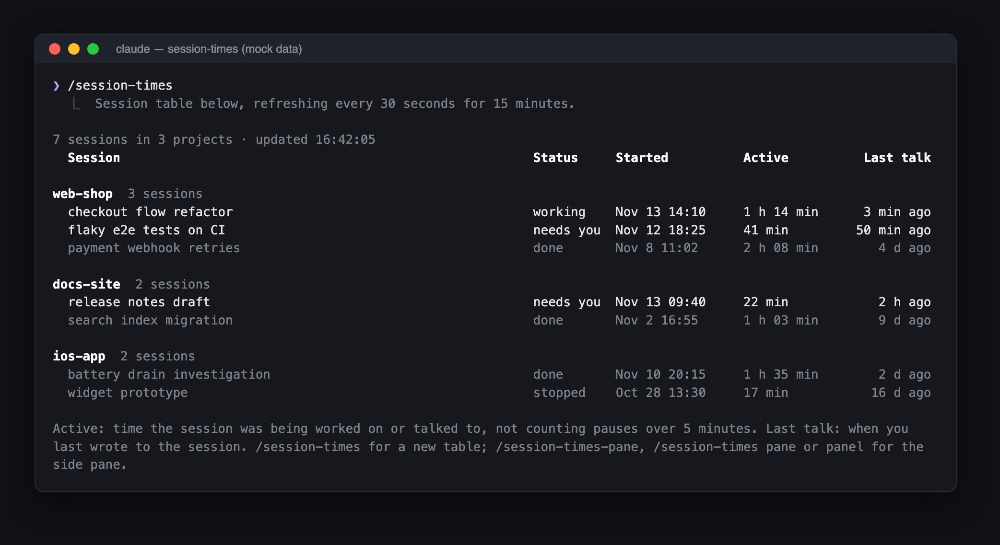
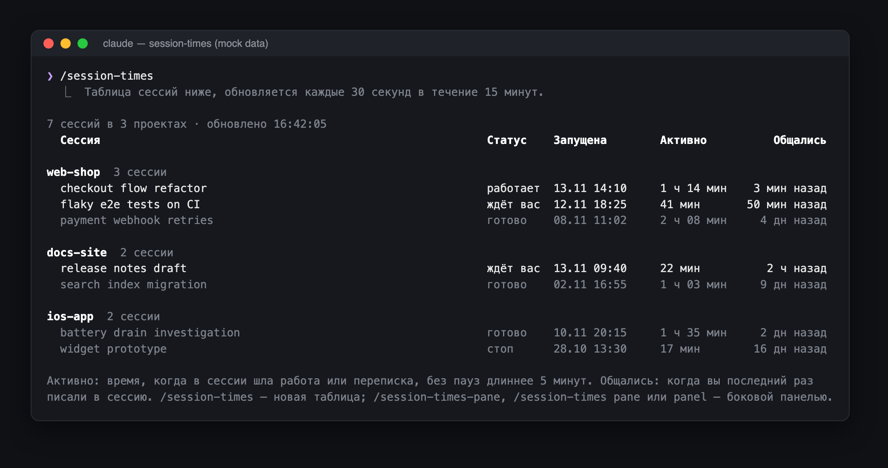

# session-times

A Claude Code mod that lists every background session, grouped by project. For each session it shows when the session started, how long it was actively worked on, and how long ago a person last wrote to it.



Claude Code's built-in agents view shows a single "age" per row. That number counts from when the session was created, and it freezes when the run finishes. So it can't answer "which sessions have I not touched for days?" This mod can.

## What it shows

| Column    | Meaning |
| --------- | ------- |
| Session   | Session name, as in the agents view |
| Status    | working / needs you / done / stopped |
| Started   | When the session was created (local time) |
| Active    | Active time: the sum of gaps between consecutive transcript entries that are at most 5 minutes apart. Nights and long waits for a reply don't count |
| Last talk | Time since the last message a person typed into the session. Task notifications and system reminders don't count |

Sessions are grouped by the folder they were started in. Worktrees are folded into their repository. Project names are shown in bold, with a session count next to each. Groups, and the sessions inside each group, are sorted by the most recent conversation. Finished and stopped sessions are dimmed.

## Usage

- `/session-times` prints the table into the transcript at full terminal width. The table refreshes every 30 seconds for 15 minutes, then stops. Run the command again for a fresh table at the bottom of the transcript.
- `/session-times-pane` opens the same table as a side pane. So do `/session-times pane` and `/session-times panel`. The separate command exists because Claude Code's command typeahead lists commands, not their arguments; `/session-times` only shows a dim `[pane|panel]` hint. Claude Code caps a side pane at 45% of the terminal width. The pane opens focused and keeps refreshing while it is open.
  - `r` refreshes
  - `Esc` or `x` closes the pane
  - `Tab` moves between the buttons and `Enter` presses one
  - The arrow keys scroll

## Language

The interface is available in English (the default) and Russian. Set the `language` option to `en` or `ru`:

- in `/config`, on the session-times row, or
- in `~/.claude/settings.json`:

  ```json
  { "pluginConfigs": { "session-times": { "options": { "language": "ru" } } } }
  ```

With `ru`, the table looks like this:



## Install

Clone the repository, then load the folder as a plugin folder:

```sh
git clone https://github.com/maximhoffman/session-times.git ~/session-times
```

- For one session: `claude --plugin-dir ~/session-times`
- For every session: add the folder to `CLAUDE_CODE_PLUGIN_DIRS` in the `env` block of `~/.claude/settings.json`. Separate several folders with `:`.

  ```json
  { "env": { "CLAUDE_CODE_PLUGIN_DIRS": "~/session-times" } }
  ```

The mod needs `python3` on `PATH`. It only reads background sessions, the ones listed in `claude agents`.

## How it works

- `bin/session_times.py` collects the data. It reads `~/.claude/jobs/*/state.json` (name, state, creation time, project folder, transcript path) and each session's transcript.
  - Transcripts are append-only. Each one is read in full once, and after that only from the offset reached last time.
  - Partial totals are cached in `~/.cache/claude-session-times/cache.json`, or under `$XDG_CACHE_HOME` if it is set.
  - A full run over about 40 sessions (~130 MB of transcripts) takes about 0.4 s the first time and about 0.02 s after that.
- `hooks/register.tsx` is the hooks module. It registers the commands, runs the collector through `$.process.run`, keeps the latest snapshot in `$.state`, and draws the table in both views.
- `hooks/strings.ts` holds every text of the interface, in English and Russian.
- `types/index.d.ts` declares the shape of the state.

Active time isn't taken from the session's state timeline (`timeline.jsonl`). That timeline proved unreliable in both directions: one session stayed "working" overnight for 14 hours with no activity, and recent work went unrecorded.

The screenshots show the mod's real output, rendered by `claude plugin test` from mock sessions.

## Development

```sh
claude plugin validate .
claude plugin test .
```

Claude Code generates `.claude-plugin/types/` when it loads the mod. That folder is ignored by git, and `tsconfig.json` extends it.

## License

MIT
